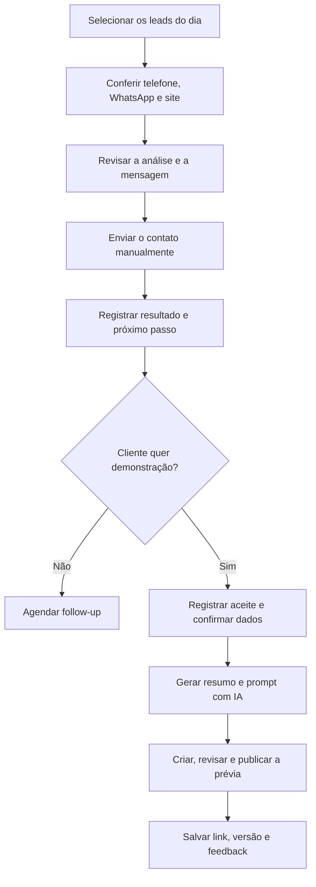

# Guia de Uso do CRM

> Manual operacional das funções atuais do Prospector CRM. A IA prepara análises, mensagens e materiais; Henrique revisa e decide antes de qualquer contato com o cliente.

## Visão geral do fluxo



## 1. Começar o dia

1. Abra o dashboard e confira os números do funil.
2. Veja os follow-ups previstos ou atrasados.
3. Priorize leads com maior score e estágio **Analisado**.
4. Trabalhe com a meta de **10 novos contatos por dia**.
5. Antes de enviar qualquer mensagem, abra a ficha do lead e confirme os dados.

A meta diária é uma referência de produtividade, não uma autorização para disparo automático. O contato continua manual e revisado por Henrique.

## 2. Conferir os dados do lead

Antes da abordagem, confira:

- nome da empresa;
- nome do responsável, quando disponível;
- segmento e cidade;
- primeiro telefone;
- link de WhatsApp;
- site;
- Instagram e Google Maps, quando disponíveis;
- análise, score, prioridade e abordagem sugerida.

### Regra do WhatsApp

Se o lead não tiver um link específico de WhatsApp, o CRM utiliza o **primeiro número de telefone** para montar o contato no WhatsApp. Antes de enviar:

1. confirme se o número parece válido;
2. verifique o DDD;
3. abra o link;
4. revise o destinatário e a mensagem.

Se o WhatsApp informar que o número não existe, use ligação, Instagram, formulário do site ou outro canal disponível.

### Regra do site

Um lead pode já ter site. O endereço deve aparecer na ficha sempre que estiver cadastrado.

- **Sem site:** ofereça presença digital e uma demonstração inicial.
- **Com site:** analise velocidade, experiência no celular, clareza da oferta, SEO local e facilidade de contato.
- Não diga que a empresa não tem site sem conferir o campo e abrir o endereço.
- Use o site existente para personalizar a abordagem e sugerir melhorias concretas.

## 3. Revisar e enviar a mensagem

O CRM prepara textos de abordagem, mas Henrique deve revisar o conteúdo antes do envio.

As mensagens podem mencionar que Henrique:

- é desenvolvedor web da região de Santos;
- trabalha com presença digital para negócios locais;
- já atende a **JM Motors, em Santos**, como referência real de experiência;
- identificou uma oportunidade específica para a empresa abordada.

Use a JM Motors como prova de experiência, sem inventar resultados, números, depoimentos ou métricas.

### Escolher a abordagem

- **Completa:** primeiro contato com contexto e proposta de valor.
- **Curta:** contato direto quando o canal pede objetividade.
- **Demonstração:** quando existe uma ideia visual clara ou o lead demonstrou interesse.
- **Site existente:** fale sobre oportunidades verificadas no site atual, não sobre ausência de site.

Depois do envio, registre uma observação com data, canal e resumo do contato.

## 4. Registrar resultado e próximo passo

Atualize o estágio do lead conforme a conversa evolui. Exemplos:

- **Novo / Analisado:** ainda não contatado.
- **Contatado:** primeira abordagem enviada.
- **Respondeu / Qualificado:** houve retorno e existe oportunidade.
- **Proposta / Negociação:** escopo ou valor em discussão.
- **Ganho:** contratação confirmada.
- **Perdido:** sem interesse ou sem aderência.

Sempre que possível, registre:

- resposta do cliente;
- objeção principal;
- data do próximo follow-up;
- canal preferido;
- ação combinada;
- observações úteis para a próxima conversa.

Um bom próximo passo é específico: “Enviar demonstração na quarta-feira” é melhor do que “Falar depois”.

## 5. Oferecer uma demonstração

A demonstração não deve ser gerada automaticamente no primeiro contato. Primeiro, apresente a ideia e registre a resposta do cliente.

Estados possíveis:

- **Não oferecida:** a ideia ainda não foi apresentada.
- **Oferecida:** o cliente recebeu a proposta de demonstração.
- **Aceita:** o cliente autorizou a preparação.
- **Recusada:** o cliente não quer seguir com a demonstração.

Quando o cliente aceitar:

1. registre o aceite no CRM;
2. confirme nome, serviços, telefone, WhatsApp, endereço, site e redes sociais;
3. confirme o objetivo da página;
4. registre preferências visuais e referências, se houver;
5. só então gere o pacote da demonstração.

## 6. Gerar o pacote com IA

A geração cria dois materiais principais:

- **Resumo estratégico:** visão do negócio, público, objetivo, estrutura recomendada, argumentos e chamadas para ação.
- **Prompt completo:** instruções prontas para uma IA de criação de sites, como Lovable, Bolt, v0, Replit ou outra ferramenta.

O prompt deve usar os dados confirmados do lead e pode incluir:

- estrutura das seções;
- estilo visual;
- textos sugeridos;
- serviços e diferenciais;
- botões e chamadas para WhatsApp;
- requisitos para celular;
- SEO local;
- referências e restrições.

### Checklist antes de usar o prompt

- O cliente aceitou a demonstração?
- Os dados foram confirmados?
- O telefone e o WhatsApp estão corretos?
- O site existente foi considerado?
- Nenhuma métrica foi inventada?
- O texto está coerente com o segmento e a cidade?
- A referência à JM Motors é verdadeira e apropriada?

Copie o prompt, abra a IA escolhida, gere a primeira versão e revise manualmente antes de publicar ou apresentar.

## 7. Controlar versões da demonstração

Use as versões para manter o histórico:

- **V1:** primeira proposta visual.
- **V2:** ajustes após a primeira revisão.
- **V3 ou superior:** refinamentos adicionais.

Para cada versão, salve no CRM:

- status;
- link da prévia;
- feedback do cliente;
- alterações solicitadas;
- próximo passo;
- data de atualização.

Não substitua o histórico apenas porque uma versão nova foi criada. O histórico ajuda a entender decisões, objeções e evolução do projeto.

## 8. Enviar a demonstração ao cliente

Antes do envio:

1. abra a prévia no computador e no celular;
2. teste menus, botões, formulário e WhatsApp;
3. confira telefone, endereço, serviços e identidade;
4. remova textos genéricos e conteúdos de exemplo;
5. confirme que o link está público;
6. registre o link na versão correta do CRM.

Mensagem sugerida:

> Preparei uma demonstração inicial para você visualizar a ideia na prática. Ela ainda pode ser ajustada com suas preferências. Posso te enviar o link e, depois que você olhar, alinhamos o que gostaria de mudar?

Depois do envio, registre a data e agende o follow-up.

## 9. Leads importados do Notion

Os leads que estavam no Notion foram importados para o CRM. A operação diária deve acontecer no CRM para evitar registros divergentes.

Ao encontrar um lead importado:

1. confira se telefone, WhatsApp e site vieram corretamente;
2. complete campos ausentes;
3. verifique se já existe contato anterior nas observações;
4. evite cadastrar a mesma empresa novamente;
5. continue o acompanhamento no CRM.

O Notion pode continuar como fonte histórica ou de planejamento, mas o CRM é a fonte operacional dos leads.

## 10. Encerramento diário

No fim do dia:

1. confira se os 10 contatos foram registrados;
2. atualize respostas e estágios;
3. agende todos os próximos passos;
4. registre links e versões das demonstrações;
5. revise follow-ups do dia seguinte;
6. sincronize o snapshot do Segundo Cérebro:

```bash
npm run brain:sync
```

Esse comando atualiza `Second Brain/CRM Snapshot.md` com o retrato atual do funil.

## Regras de segurança e qualidade

- Nenhuma mensagem é enviada sem revisão humana.
- Nenhuma demonstração é criada sem aceite e confirmação dos dados.
- O primeiro telefone só vira link de WhatsApp quando não há link específico.
- Sites existentes devem ser registrados e considerados na abordagem.
- A JM Motors pode ser citada como cliente real em Santos, sem resultados inventados.
- Dados do cliente não devem ser enviados a ferramentas externas além do necessário.
- Links e informações de contato devem ser testados antes de qualquer envio.
- O CRM registra decisões; Henrique mantém a responsabilidade pelo contato e pela proposta.

## Checklist rápido

- [ ] Escolhi até 10 novos leads prioritários
- [ ] Conferi telefone, WhatsApp e site
- [ ] Revisei a mensagem
- [ ] Enviei manualmente
- [ ] Registrei o resultado
- [ ] Defini o próximo passo
- [ ] Registrei o aceite antes da demonstração
- [ ] Confirmei os dados antes de gerar com IA
- [ ] Salvei link, versão e feedback
- [ ] Organizei os follow-ups do dia seguinte

Relacionadas: [[Prospector CRM Index]] · [[Operating System]] · [[Sales Playbook]] · [[Playbook - Demonstracoes e Mockups com Lovable]] · [[Playbook - Rotina Diaria e Find Skills]] · [[Agent And AI Guardrails]] · [[Roadmap]]
