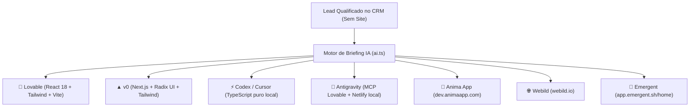

# Playbook — Geradores de Demonstração IA: Lovable, v0, Codex, Antigravity MCP, Anima, Webild e Emergent

> **Objetivo:** Guia prático para criar protótipos de landing pages e web apps em qualquer uma das 7 ferramentas integradas ao Prospector CRM, permitindo apresentar uma proposta visual impactante antes do fechamento.

---

## 🧭 As 7 Plataformas Suportadas

O **Prospector CRM** adapta automaticamente o formato do prompt, as diretrizes de código e o link de acesso direto para cada uma das plataformas:

---

## 📋 Detalhamento por Plataforma

### 1. 💜 Lovable (`https://lovable.dev`)
* **Ponto Forte:** Aplicações completas em React 18, Tailwind CSS e componentes shadcn/ui com sincronização para o GitHub.
* **Como Usar:** Abra o projeto no Lovable, cole o prompt formatado e visualize a URL interativa `https://preview--[cliente].lovable.app`.
* **Suporte MCP:** Possui servidor MCP ativo no Antigravity!

### 2. ▲ v0 by Vercel (`https://v0.dev`)
* **Ponto Forte:** Geração generativa rápida de componentes de UI em Next.js com Radix UI e Tailwind.
* **Como Usar:** Cole o prompt na caixa de mensagem do v0.dev e refine as seções de forma conversacional.

### 3. ⚡ Codex / Cursor (Editor de Código Local)
* **Ponto Forte:** Geração de código-fonte TypeScript/React sem intermediários web, ideal para montar projetos locais em `demos/[slug]/`.
* **Como Usar:** Copie o prompt estruturado e utilize o atalho de IA do seu editor (Cursor `Ctrl + K` / `Ctrl + L` ou OpenAI Codex).

### 4. 🤖 Antigravity (Aqui com Você / MCP Ativo)
* **Ponto Forte:** Zero atrito de context-switch. Você pede diretamente no chat do agente:
  > *"Crie uma landing page de demonstração para o lead Clínica OdontoSantista usando o MCP do Lovable ou gere o código React na pasta demos/ e publique no Netlify via MCP."*
* **Servidores Ativos:** MCP do Lovable (`mcp_lovable_*`) e MCP do Netlify (`mcp_netlify_*`).

### 5. 🎨 Anima App (`https://dev.animaapp.com/`)
* **Ponto Forte:** Conversão de design visual e geração de código React limpo com alta fidelidade estética e layout responsivo mobile-first.
* **Como Usar:** Acesse [dev.animaapp.com](https://dev.animaapp.com/), inicie um novo projeto com IA e cole o prompt focado em especificações de design e hierarquia.

### 6. 🌐 Webild (`https://www.webild.io/`)
* **Ponto Forte:** Construtor de sites comerciais orientado a velocidade extrema e conversão local para pequenas e médias empresas.
* **Como Usar:** Abra [webild.io](https://www.webild.io/), crie um site e cole o prompt estruturado em seções comerciais (Hero, Serviços, Diferenciais, Google Maps e WhatsApp flutuante).

### 7. 🚀 Emergent (`https://app.emergent.sh/home`)
* **Ponto Forte:** Geração de aplicações web funcionais completas com fluxos interativos de agendamento e captura de leads.
* **Como Usar:** Acesse [app.emergent.sh/home](https://app.emergent.sh/home), crie uma nova aplicação e use o prompt com o fluxo interativo de agendamento em 3 etapas.

---

## 🔄 Fluxo de Trabalho Recomendado

1. **Gere o Briefing:** No Drawer do Lead (aba **Demonstrações IA**), clique em **"Gerar Briefing e Prompt com IA"**.
2. **Escolha a Plataforma:** Clique no chip da ferramenta desejada (Lovable, v0, Codex, Antigravity, Anima, Webild ou Emergent).
3. **Abra e Cole:** Use o botão **"Abrir [Plataforma] ↗"** e copie o prompt otimizado em 1 clique com **"Copiar Prompt"**.
4. **Salve a URL:** Cole o link gerado (ex: `https://preview--cliente.lovable.app`, `https://cliente.webild.io` ou link do Netlify) no campo de URL e clique em **"Salvar Link"**.
5. **Apresente ao Cliente:** Use o botão **"Testar Ao Vivo ↗"** para auditar no celular e envie a Pergunta 2 do Playbook:
   > *"E se o próximo cliente estiver procurando por você no celular... Montei uma demonstração interativa: [Link]. Leva 40 segundos para testar!"*

---

Relacionadas: [[Prospector CRM Index]] · [[Operating System]] · [[Sales Playbook]] · [[Playbook - Demonstracoes e Mockups com Lovable]] · [[Agent Skills and Capabilities]]
