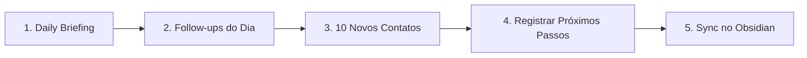

# Playbook — Rotina Diária e Descoberta de Skills

> **Objetivo:** Estabelecer uma rotina comercial diária com o Prospector CRM, realizar 10 novos contatos com qualidade e ensinar como expandir o repertório de ferramentas usando o comando `/find-skills`.

---

## 1. A Rotina Comercial Diária de Henrique

Para manter o funil de vendas sempre cheio e fechar contratos recorrentes:



### 1. Iniciar o dia com `daily-briefing`

Peça ao assistente:

> *"Gere meu daily-briefing com base nos leads do Prospector CRM. Quais follow-ups vencem hoje e quais são as empresas mais quentes para contato?"*

### 2. Fazer os follow-ups agendados

- Abra o painel do CRM na seção **Próximos follow-ups**.
- Abra o lead e revise a conversa anterior.
- Use o WhatsApp com texto pronto somente depois de revisar o número e a mensagem.
- Registre a resposta e defina uma nova data ou ação específica.

### 3. Fazer 10 novos contatos

- Na tabela do CRM, filtre por leads com estágio **Analisado** e alta prioridade.
- Confirme telefone, WhatsApp e site antes de abordar.
- Se não houver link de WhatsApp, use o primeiro telefone como tentativa de WhatsApp.
- Se houver site, abra e considere o site atual na abordagem.
- Escolha a variação mais adequada: Completa, Curta, Site existente ou Demonstração.
- A mensagem pode citar que Henrique já atende a **JM Motors, em Santos**, sem inventar resultados.
- Envie manualmente e registre o resultado no CRM.

### 4. Registrar próximos passos e demonstrações

- Todo contato deve terminar com uma ação registrada: follow-up, ligação, envio de proposta ou demonstração.
- Se o cliente aceitar uma demonstração, registre o aceite e confirme os dados.
- Gere o resumo estratégico e o prompt para Lovable, Bolt, v0, Replit ou outra IA.
- Revise a prévia, salve o link e controle as versões V1, V2 e V3+.
- Registre o feedback e o próximo passo de cada versão.

Consulte [[Guia de Uso do CRM]] para o procedimento completo.

### 5. Sincronizar o Segundo Cérebro

No final do dia, rode no terminal:

```bash
npm run brain:sync
```

Isso atualiza o retrato do funil comercial dentro de `Second Brain/CRM Snapshot.md`.

---

## 2. Como Usar o `/find-skills` para Achar Novas Ferramentas

O ecossistema aberto de skills possui centenas de automações prontas no [https://skills.sh](https://skills.sh). Sempre que surgir uma necessidade nova, use o comando:

### Exemplo 1: Buscar automações de Redes Sociais / LinkedIn

```bash
npx skills find linkedin
```

### Exemplo 2: Buscar automações de Contratos e Jurídico

```bash
npx skills find contract
```

### Exemplo 3: Instalar uma Skill Encontrada Globalmente

```bash
npx skills add <owner/repo@skill> -g -y
```

### Skills já instaladas e prontas no seu PC

- `seo-audit` — auditoria de SEO técnico on-page
- `proposal-writer` — geração de propostas comerciais
- `find-skills` — busca e instalação de novos pacotes
- `daily-briefing` — plano de ação matinal priorizado
- `pipeline-review` — auditoria de gargalos no funil

---

Relacionadas: [[Guia de Uso do CRM]] · [[Agent Skills and Capabilities]] · [[Operating System]] · [[Prospector CRM Index]] · [[Sales Playbook]]
