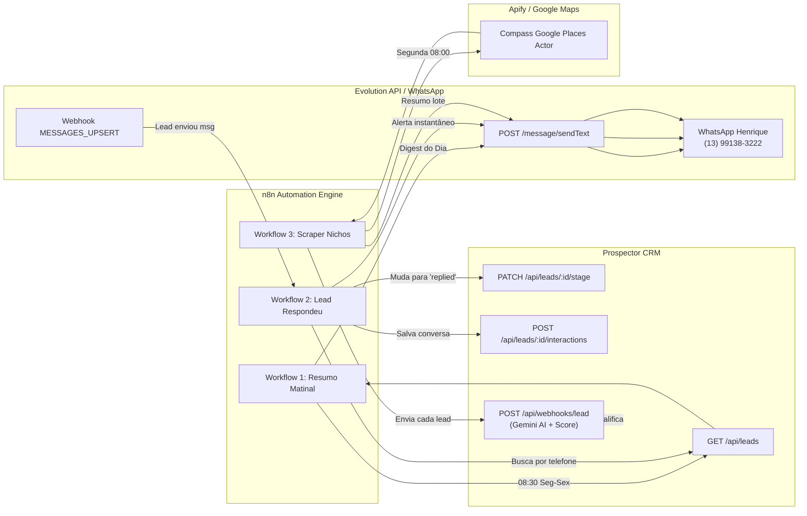

# Integração Prospector CRM + n8n + WhatsApp (Evolution API)

Guia definitivo de automação comercial e prospecção ativa para **Henrique Bezerra dos Santos**.

---

## 🧭 Visão Geral da Arquitetura

O ecossistema combina a velocidade do **n8n** (orquestrador de gatilhos, cron e webhooks) com a inteligência do **Prospector CRM** (qualificação com Gemini AI, cálculo de Score e Playbook de Vendas) e a **Evolution API** (mensageria de WhatsApp open-source).



---

## 📦 Workflows Disponíveis (Prontos para Importação)

| Arquivo | Nome | Gatilho | Ação Principal |
| :--- | :--- | :--- | :--- |
| [`workflow-1-followup-digest.json`](file:///c:/Users/conta/OneDrive/Documentos/ChatGPT/CRM/integrations/n8n/workflow-1-followup-digest.json) | **Resumo Matinal de Follow-ups** | Cron Seg-Sex 08:30 | Envia resumo formatado no seu WhatsApp com follow-ups do dia, leads que responderam e meta diária. |
| [`workflow-2-whatsapp-replies.json`](file:///c:/Users/conta/OneDrive/Documentos/ChatGPT/CRM/integrations/n8n/workflow-2-whatsapp-replies.json) | **Lead Respondeu no WhatsApp** | Webhook Evolution API | Identifica o lead por telefone, move para `Respondeu`, registra a conversa no histórico e envia alerta push para você. |
| [`workflow-3-apify-gmaps-prospector.json`](file:///c:/Users/conta/OneDrive/Documentos/ChatGPT/CRM/integrations/n8n/workflow-3-apify-gmaps-prospector.json) | **Scraper Google Maps (Apify)** | Cron Semanal / Manual | Raspa nichos da Baixada Santista e envia em lote para o Webhook do CRM, onde a Gemini AI analisa cada empresa. |

---

## ⚙️ Variáveis de Ambiente no n8n

Para que os workflows funcionem sem você precisar alterar nós individualmente, configure as variáveis de ambiente no seu container do n8n (no `.env` do Docker ou nas **Variables** do n8n em `Settings > Variables`):

```bash
# URLs do Prospector CRM
PROSPECTOR_API_URL=https://api-prospector-delta.vercel.app
PROSPECTOR_WEB_URL=https://prospector-crm-pessoal.vercel.app

# WhatsApp de Henrique para Alertas
HENRIQUE_WHATSAPP_NUMBER=5513991383222

# Evolution API (WhatsApp)
EVOLUTION_API_URL=https://sua-evolution-api.com
EVOLUTION_API_KEY=sua_chave_global_ou_da_instancia
EVOLUTION_INSTANCE=principal

# Apify (Workflow 3 - Google Maps Scraper)
APIFY_API_TOKEN=apify_api_token_aqui
```

> [!TIP]
> Se você estiver rodando o CRM localmente em desenvolvimento, basta alterar `PROSPECTOR_API_URL=http://localhost:3333` ou usar uma URL de túnel como o Ngrok / Localtunnel.

---

## 🚀 Como Importar no seu n8n (Passo a Passo)

1. Abra o seu **n8n**.
2. Clique no menu superior direito do painel de workflows: **`...` (More options) > `Import from File`** (ou pressione `Ctrl + V` na tela colando o conteúdo do arquivo JSON).
3. Selecione o arquivo desejado:
   * `workflow-1-followup-digest.json`
   * `workflow-2-whatsapp-replies.json`
   * `workflow-3-apify-gmaps-prospector.json`
4. Clique em **Save** e ative a chave **Active** (se já configurou as variáveis de ambiente).

---

## 📲 Configuração do Webhook na Evolution API (Para o Workflow 2)

Na sua instância da Evolution API, você deve apontar o webhook para o n8n:

1. Acesse o painel da Evolution API ou faça uma requisição `POST /webhook/set/{sua-instancia}`:
```json
{
  "enabled": true,
  "url": "https://seu-n8n.com/webhook/evolution-messages-upsert",
  "webhook_by_events": false,
  "events": [
    "MESSAGES_UPSERT"
  ]
}
```
2. No n8n, quando um cliente responder ao seu WhatsApp comercial, o evento cairá instantaneamente no Workflow 2.
3. O n8n filtra mensagens de grupos (`@g.us`), ignora mensagens que você mesmo enviou (`fromMe: true`) e processa apenas clientes reais.

---

## 🛡️ Princípio Human-in-the-Loop (`AGENTS.md`)

Conforme a regra inviolável do repositório:
> **A automação coleta, organiza, qualifica e avisa. O humano revisa, decide e envia.**

* O n8n **nunca** enviará uma proposta ou abordagem de venda fria para o cliente sem o seu clique no CRM.
* Os envios automáticos para o WhatsApp são restritos a **você mesmo** (notificações matinais e alertas push de novos leads respondendo).
